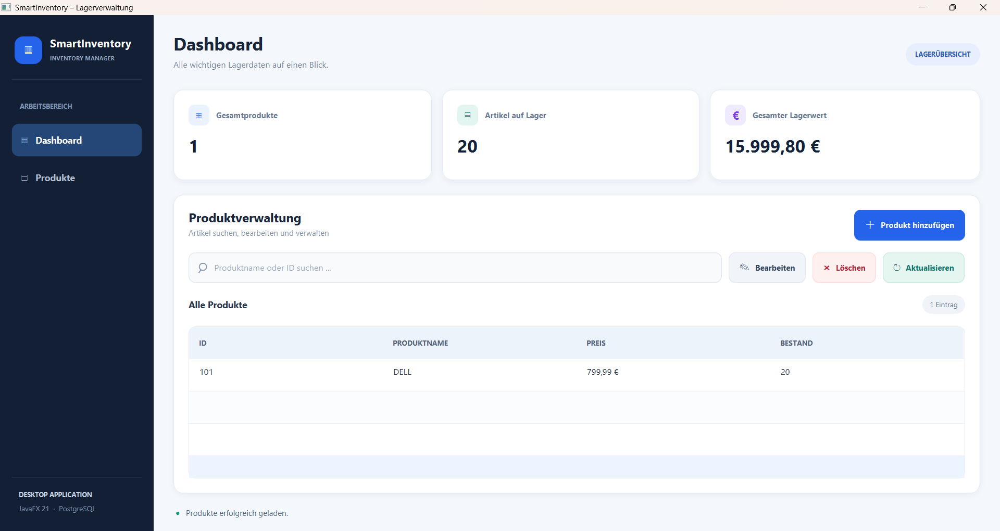
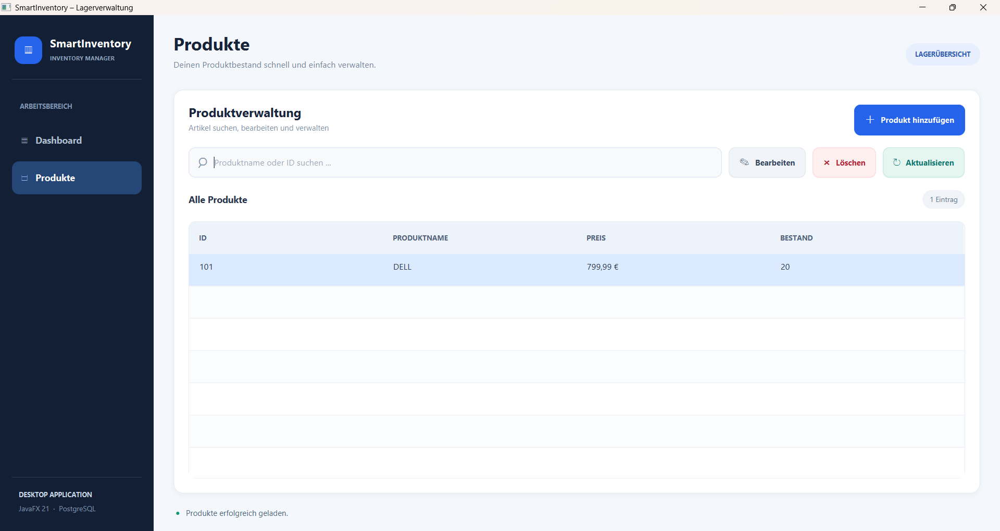
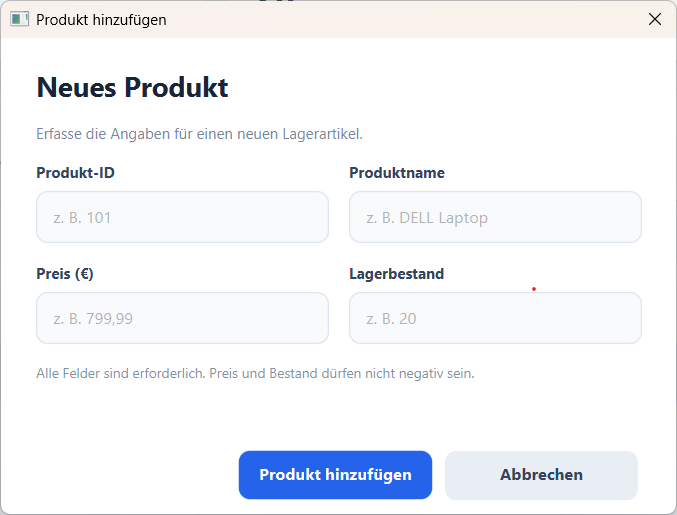
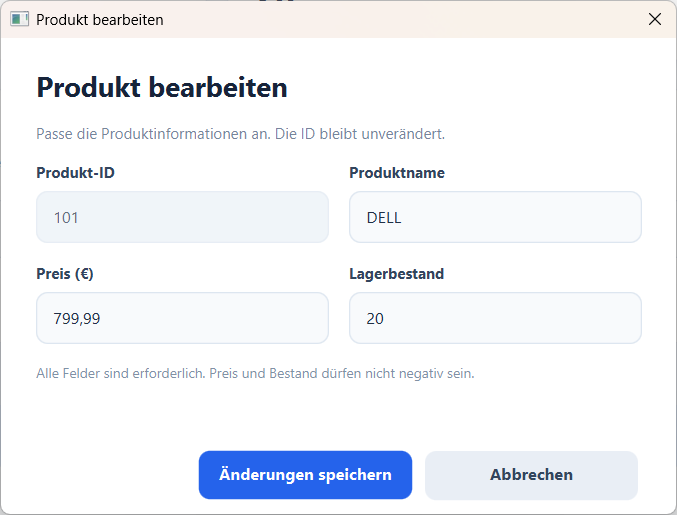
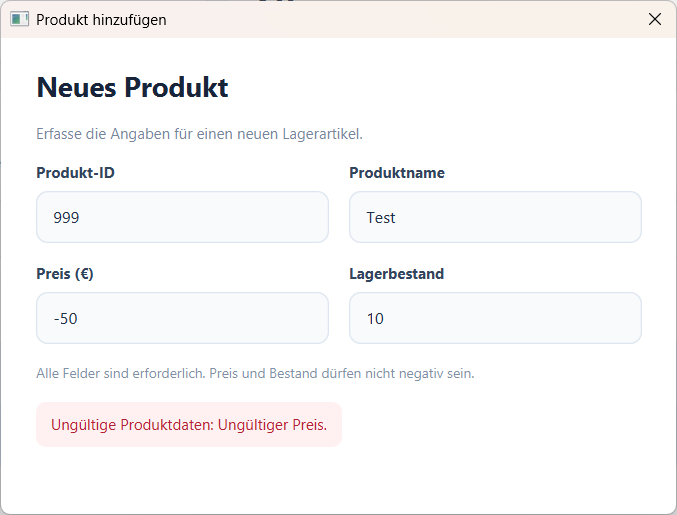
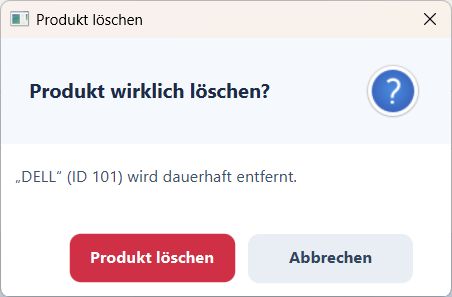

# SmartInventory

### Modern Inventory Management Desktop Application

SmartInventory is a desktop inventory management application built with **Java 21, JavaFX, and PostgreSQL**.

The application provides a modern dashboard for managing products, monitoring stock quantities, and tracking inventory value. It demonstrates practical Java development, object-oriented programming, database integration, and automated testing.

## Features

- **Dashboard:** Overview of total products, stock quantities, and inventory value.
- **Product Management:** Add, view, edit, and delete products.
- **Live Search:** Search for products by name or ID.
- **Input Validation:** Prevent invalid product data.
- **Database Persistence:** Store and retrieve products using PostgreSQL and JDBC.
- **Modern UI:** JavaFX interface with custom CSS styling.
- **Error Handling:** Informative validation and database error messages.

## Screenshots

### Dashboard
Overview of inventory statistics and stock value.



### Product Management
Manage products through a modern interface.



### Add Product
Add new products to the inventory.



### Edit Product
Update existing product information.



### Input Validation
Invalid product data is rejected with a clear error message.



### Delete Confirmation
Confirmation is required before deleting a product.



## Tech Stack

| Technology | Purpose |
|---|---|
| Java 21 | Application logic |
| JavaFX 21 | Desktop user interface |
| PostgreSQL | Relational database |
| JDBC | Database connectivity |
| Maven | Build and dependency management |
| JUnit 5 | Unit testing |
| CSS | User interface styling |
| Git & GitHub | Version control |

## Project Structure

```text
SmartInventorz/
├── src/
│   ├── main/
│   │   ├── java/org/example/
│   │   │   ├── InventoryApp.java
│   │   │   ├── Product.java
│   │   │   ├── ProductRepository.java
│   │   │   ├── DatabaseConnection.java
│   │   │   ├── DatabaseTest.java
│   │   │   ├── InventoryManager.java
│   │   │   └── Main.java
│   │   └── resources/
│   │       └── style.css
│   └── test/java/org/example/
│       └── ProductTest.java
├── pom.xml
├── .gitignore
└── README.md
```

## Getting Started

### Prerequisites

- Java JDK 21
- Apache Maven
- PostgreSQL
- IntelliJ IDEA or another Java IDE

### Database Setup

Create a PostgreSQL database named:

```sql
CREATE DATABASE smart_inventory;
```

The application uses a `products` table with the following columns:

| Column | Java Type | Description |
|---|---|---|
| `id` | `int` | Product identifier |
| `name` | `String` | Product name |
| `price` | `double` | Product price |
| `quantity` | `int` | Available stock |

After creating the `smart_inventory` database, execute
the SQL script below to create the required `products` table:

[Database Schema](database/schema.sql)

The script defines the product columns, primary key,
and database constraints.

### Database Connection

The application currently expects these local connection settings:

```text
Host: localhost
Port: 5432
Database: smart_inventory
Username: postgres
```

The database password is read from an environment variable named `DB_PASSWORD`.

Configure this variable on your computer or in your IDE run configuration. Do not store passwords directly in source code or commit them to GitHub.

### Run the Application

Clone the repository:

```bash
git clone https://github.com/devpath-nrw/SmartInventory.git
```

Open the project in IntelliJ IDEA, configure PostgreSQL and `DB_PASSWORD`, and run:

```bash
mvn javafx:run
```

The JavaFX entry point is `org.example.InventoryApp`.

The repository also contains an earlier console-based implementation in `Main.java`.

## Testing

The project includes five JUnit 5 unit tests covering:

- Valid product creation
- Negative price validation
- Negative quantity validation
- Empty product name validation
- Invalid product ID validation

Run `ProductTest.java` using your IDE's JUnit test runner.

## Possible Future Improvements

- CSV import and export
- Additional database integration tests
- Low-stock alerts
- Improved database setup automation
- Application packaging for easier installation

## About This Project

SmartInventory is a personal software development portfolio project built to strengthen practical skills in Java, object-oriented design, SQL databases, desktop applications, unit testing, and Git workflows.